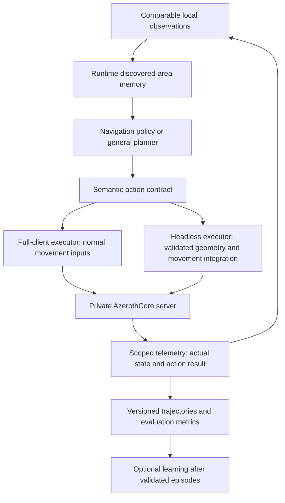

# WAI client and headless transition plan

Drafted October 27, 2026. Research and design only; no implementation, installation, client launch,
server mutation, build or model update has been performed for this plan.

## Decision and scope

Goal: one general navigation/controller interface that can operate either a logged-in character
through the full WoW 3.3.5a client or lightweight headless sessions. No fixed dungeon route, boss
coordinates, prescribed boss order or dungeon-specific training requirement.

Headless operation is not intrinsically unsuitable for learning. The current problem is permissive
movement and insufficient evidence of progress. A protocol-only headless client does not contain
Blizzard's collision engine. Replacing server bot movement with packets alone would retain the
same fundamental ability to report impossible positions. Full-client input provides a useful
reference behavior, not proof that an arbitrary replacement has matching physics.

Recommended order: full-client movement reference, shared action/state contract, headless movement
parity, then short navigation experiments. Do not replace the existing system wholesale before
those gates pass. Preserve its episode manager, logs, checkpoint tooling and native combat where useful.

## Proposed architecture

Separate controller decisions from execution. Start with the existing small policy for interface
probes, but do not confuse this transport change with fixing its exploration/planning limitations.
A general planner with discovered-area memory remains a separately evaluated architecture option.
Do not introduce a large language model as an undeclared replacement for the current PPO experiment.

## Research: reuse candidates

| Candidate | Reusable part | Important limitation |
|---|---|---|
| [agent-wow](https://github.com/agent-wow/agent-wow) | Authentication, persistent 3.3.5a session, protocol/module plumbing and local RPC | Current docs specify Linux plus Docker/Compose and Go for source installation. Movement/combat modules must be supplied; it does not inherit the official client's collision engine. Assess WSL2 versus native integration before adopting. |
| [Existing Recast/Detour and AzerothCore geometry](https://github.com/recastnavigation/recastnavigation) | Reuse current navmesh path queries and extracted collision data | A path query is not complete character physics. Missing tiles, incomplete routes and collision gaps need explicit failure results, never direct-line fallback. |
| [AmeisenNavigation](https://github.com/Jnnshschl/AmeisenNavigation) | Windows/Linux navigation service and query interface | Candidate adapter, not a WoW login client or proof of movement parity. Validate binary data formats/version compatibility before reusing existing tiles. |
| [namigator](https://github.com/namreeb/namigator) | WotLK-compatible pathfinding library, asset parser/builder and debugging viewer | Alternative navigation stack; generated data is not assumed interchangeable with current mmaps. Benchmark before introducing a second asset pipeline. |
| [Wowless](https://wowless.dev/) | Addon API testing | Not a headless gameplay/physics client; unsuitable as the training executor. |

Experimental open-source rendered clients exist, but none inspected here establishes a drop-in,
client-accurate headless physics backend for our server. Do not commit to a client-engine rewrite.
The author of [the starting-zone experiment](https://agent-wow.sh/gpt-6-astra-plays-world-of-warcraft-for-the-first-time-with-agent-wow/)
used a generated Detour helper over mmaps and reported collision exploits as well. Protocol access
alone did not solve physical validity. The later [Ragefire experiment](https://agent-wow.sh/five-agents-running-on-gpt-61-sol-clear-world-of-warcrafts-ragefire-chasm-in-24-hours/)
reported repeated fixes/wipes, not guaranteed first-attempt transfer to unseen dungeons.

## Phase 0: preserve evidence and establish ownership

- Snapshot/checksum the current checkpoint and retain recordings. Tag old rollouts with their
  executor/geometry/reward versions; do not mix new-backend transitions into old PPO batches.
- Do not stop an active process automatically. Switch environments only at an explicit session
  boundary after any checkpoint write finishes. This draft does not change the running server.
- For a full-client controlled character, server AI must not simultaneously issue movement,
  teleports, casts or target changes. Exactly one control owner per character.
- Use a separate test character before an existing playable character. Never log the same
  character into the full and headless clients simultaneously; handover requires clean session
  release, acknowledged login, fresh state and a new control lease.

## Phase 1: smallest full-client proof

One logged-in character, one visible low-resource client, short sessions, no training. The
external executor translates semantic intents such as turn, forward, stop and strafe to ordinary
input events. The real client performs ordinary collision handling. Bindings are discovered or
configured; the policy stores intent/ability identity rather than fixed physical keys.

An addon alone cannot autonomously drive protected movement/casting as required. Plan on an
external input executor plus scoped read-only telemetry. Ability intents map to configured action
buttons and normal client input; do not assume arbitrary spell IDs can be cast by addon Lua.
No binary patches, client injection or server relocation commands are proposed for normal actions.

Initially reuse available server observations only after filtering them to the controlled
character's permitted local state. Supplement with client addon-visible state/screenshots where
necessary. Select and validate the telemetry transport in the spike; an addon cannot simply open
a general TCP connection or write arbitrary live JSON files.

Acceptance: a forward action walks normally; walking into a wall stops at the wall; stop releases
input. Manual takeover, focus loss, disconnect or stale observation releases held keys and stops
sending input. Never type movement into chat or another application. Record intent, key-down/up,
timestamps, actual displacement, heading and observed result.

## Phase 2: shared action and observation contract

Actions: heading-relative move/turn with a bounded duration, stop/wait, target selection and
ability intent when combat is introduced. Both backends report attempted, started, completed,
blocked, stuck or interrupted separately. A blocked move is a valid experience, not an invalid
training episode. Do not silently relocate to a reachable destination or claim full success.

Observations: pose/velocity, local entities and visibility, combat/resources/party state,
action outcome and discovered-area memory. If local geometry sensing is supplied, supply the
same information budget in both modes. Unknown geometry stays unknown; no global boss list or
hidden position query enters the policy. Backend-only collision checks enforce physics without
revealing a preferred exploration direction to the policy.

Use one physics/control time convention, measured action duration and sequence receipts. Capture
input latency and server update timing; do not assume a nominal sleep equals actual movement time.
Record backend, build/asset IDs, action schema, sensor schema and reward versions in each rollout.

## Phase 3: headless spike and physical validity

Prototype one agent-wow session or a small adapter to existing server-controlled execution; keep
it behind the same contract. Reuse the current geometry stack before importing a second system.
A true headless gameplay session needs authenticated login, packet/object state tracking,
movement timing/flags/acknowledgements and a collision-aware movement implementation. Grounded
walking needs body sweep, floor support, step/slope behavior and stops at blocking geometry.
Initial scope excludes jumping, swimming, flying, vehicles, transports and knockbacks; those must
be detected as unsupported states, not silently simulated incorrectly.

Navmesh routes alone are insufficient: validate actual executed segments against collision and
support, reject missing data and direct-line fallback, and keep the previous valid position when
a move is blocked. Server-side guards provide a backstop but do not replace testing. No forced
endpoint snapping, hidden teleports or complete-run rejection for ordinary contact with a wall.
If a true escape occurs despite this, preserve diagnostics and retain the configured terminal
penalty policy rather than credit inaccessible space as exploration.

## Phase 4: paired validation plan

These are engineering fixtures to test movement semantics, not routes supplied to the model.
Pick reproducible locations from real geometry, then run the same action traces through each
backend from equivalent initial poses. Setup/reset relocations are labelled and excluded from
policy data. The full client is the behavioral reference; compare actual positions and support,
not only success booleans. Review discrepancies with screenshots and geometry traces.

| Fixture | Expected behavior |
|---|---|
| Open floor: forward/turn/strafe/stop | Consistent speed, heading and stopping; no unexplained relocation |
| Solid wall at multiple approach angles | Stop or slide along the surface; no crossing |
| Corner and narrow doorway | No diagonal clipping; passage works when the body genuinely fits |
| Ramp and ordinary step | Supported ascent/descent without artificial vertical jumps |
| Ledge/drop | Match reference grounded/falling behavior, or report unsupported state during the restricted spike |
| Stacked floors | Stay on the connected floor; do not snap to another level |
| Closed door or dynamic obstacle | Block consistently and refresh after obstacle state changes |
| Missing/unavailable geometry | Headless action reports unavailable/blocked; never direct-line success |
| Focus loss/chat/disconnect/manual takeover | Full-client input stops and all held keys release |
| Repeated wall contact | Record blocked actions without ending every episode or rewarding false coverage |

Before measurements, propose a grounded endpoint discrepancy tolerance of 0.5 yard, heading
within 5 degrees and speed within 10% after aligning observed timing. These are provisional gates,
not established physics constants. Zero wall/floor crossings in fixtures is mandatory; visual
sampling cannot prove all future geometry correct. Repeat with different angles, durations,
body sizes and multiple dungeons. Do not loosen thresholds to hide real differences.

Go/no-go: headless long training stays off until all supported fixture classes pass or discrepancies
are understood and fixed. Unsupported mechanics must remain explicit. No promised wall-clock
completion time for this investigation; the physics-parity spike is the main uncertainty.

## Phase 5: party behavior and playable-character handover

One full-client tank plus four native PlayerBots is useful for an early integration demonstration,
but is not proof of whole-party collision fidelity. Followers can still use permissive movement.
Either enforce validated execution for them too or give all controlled party members validated
headless/full-client backends before accepting a physically valid party result.

Add the user-facing take-control/release command only after the one-character movement spike.
It must verify the selected logged-in character, pause competing server AI, create a bounded
lease and provide immediate manual release. Commands proposed here are not implemented interfaces.
Later handover between executors pauses actions, logs out/releases the old session and establishes
fresh state on the new one. Observation through a separate GM is distinct from taking control.

## Phase 6: learning and generalization

- Compare frozen old/random policies under identical, validated execution conditions before
  judging learning progress. Use multiple runs and record every terminal result.
- Build local/discovered topological memory and explore unresolved branches; provide no boss
  coordinates or fixed route. Distinguish deliberate backtracking from unproductive oscillation.
- Train across different layouts and evaluate on held-out dungeons with weights frozen. Separate
  geometry/navigation transfer from encounter mechanics and party combat failures.
- Report boss/clear rate, valid reachable coverage, stuck/blocked time, genuine escapes, deaths,
  duration and recovery use. Weight changes and visited-cell count alone are not success metrics.
- Preserve the existing PPO/recording tools, but change/version actions and observations as needed.
  Old weights can be archived and optionally adapted; their transfer is not guaranteed. Do not
  automatically train PPO on mismatched/external-planner actions without their correct likelihoods.

## Resource/scaling plan

Current laptop: 16 GiB system RAM and 8 GiB GPU memory. Begin with one full client and the small
CPU policy. Do not load a large local language model and multiple rendered clients without
measurement. Measure process RAM, GPU usage, server update latency, input/observation latency and
rollout throughput. Set full-client FPS/graphics conservatively while keeping reliable input ticks.

Headless sessions remove rendering cost but still need per-character state and collision checks.
Share immutable geometry and one inference service where safe. Benchmark one party, then two;
increase only when correctness and server latency hold. Existing four-party infrastructure is
reusable, but simultaneous full-client keyboard control on one desktop needs its own focus/input
scheduling validation. Do not claim that four watcher windows solve autonomous multi-client input.

## Concrete first deliverable

A small paired movement diagnostic with one full-client-controlled test character, explicit
control ownership, wall/stop/focus tests, scoped observations and a saved trace/report. Then a
headless adapter runs the same fixture traces. No overnight training and no fresh dungeon route
are needed to decide whether the execution backend is suitable.

This document is the draft plan requested by the user, not an implementation claim. No build
command is needed for this documentation-only change; actual server/API changes may require a
rebuild when implemented and validated.
