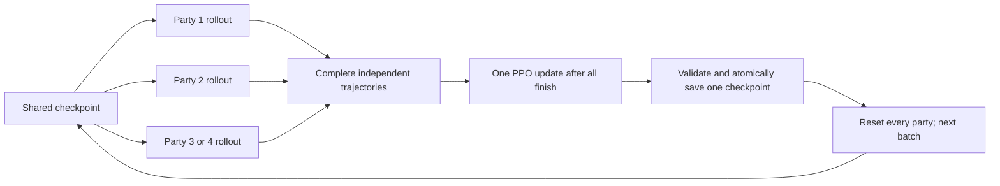

# Parallel parties, one shared model

October 26: offline checks pass. A server rebuild and live validation are required; no build,
server, controller or live database change was run during this implementation.

## Commands

Run in the server console after deploying the compatible build:

```text
waiepisode start 2
waiepisode status
waiepisode watch 1
waiepisode watch 2
```

The number is the party count, **1–4**. Omitting it defaults to one. `watch N` prints the selected
party's current tank, instance, progress and GM-client commands. It does not teleport a character
from the console. Use the printed `.appear <tank>` in your invisible, ungrouped GM's chat. If an
old binding conflicts, leave RFC, clear only your GM's binding, then appear again. Compare instance
numbers. Run-start instructions are printed for every party, and boss headlines identify the party.

```text
waiepisode party 2 status
waiepisode stop
waiepisode cleanup
```

Stop and cleanup apply to all selected parties. Wait for each cleanup receipt and the previous
controller to exit before starting a different party count. Avoid interrupting a training update.
Stopping mid-run keeps the last saved model, but the interrupted batch is not automatically trained.
After a restart with legacy clones, `waiepisode recover 2` validates and recovers the selected rosters.
It does not bypass account protections. Ordinary server startup launches no learner.

## Isolation and accounts

The same five offline characters remain read-only templates. Each party gets fresh clones, a group,
a dungeon instance, XP lock, event queues, timers, recovery, progress, telemetry and journal.
Every episode directory has a separate identity; cleanup deletes clones, not its recordings.

Party one uses `Wai.Episodes.Account`. Parties 2–4 default to that name plus `_2`, `_3`, `_4`.
Optional overrides: `Wai.Episodes.Account2`, `Account3`, `Account4`. Names must be distinct dedicated
accounts and fit the native length limit. Missing secondary accounts are created through the native
account API only when an administrator requests them. Passwords are generated privately, never
returned or logged. The base account must already exist. Accounts with unrelated/online characters
are refused; deletion continues to require the persistent account-scoped clone ownership ledger.

Movement integrity must be off for parallel operation: that optional experimental audit still owns
one roster. A parallel start with it enabled is rejected. This preserves the requested unrestricted
exploration experiment; no scripted route or undiscovered boss coordinates are supplied.

## Shared learning



One external process uses one collector thread per party. Model weights remain fixed during the
batch; early finishers wait. Only one optimizer/checkpoint writer runs under the existing file lock.
This synchronous barrier avoids mixed policy versions, at the cost of waiting for the slowest party.
It is not asynchronous PPO or several independently trained model files.

Advantage accumulation resets at terminal transitions, preventing one party's rewards from leaking
backward into another party's trajectory. Each episode has independent visit memory. Lifetime
counts start from the same snapshot and merge only new increments before checkpointing.

Clears, wipes, timeouts and dungeon exits are gameplay outcomes. Setup/infrastructure failures
quarantine the batch and stop all actors, keeping the previous checkpoint. Training failure also
stops cycling. Incomplete or unconsumed artifacts are never silently overwritten or retrained.

## Files and monitoring

Under the configured learner home:

- `navigation.pt`: the single shared model, optimizer and exploration counts.
- `episodes/<episode>/trajectory.json`, `complete.json`, `trained.json`: separate party rollouts.
- `batches/v<version>/complete.json`: participant episodes, party numbers, policy version and checksums.
- `batches/v<version>/trained.json`, `summary.json`: shared update receipts and measured changes.
- `tensorboard/`: training metrics, batch clear fraction/return and per-party time, deaths and coverage.

The short before/after model summary is printed once through party one. All parties retain their
own start/end/training receipts. Checkpoint version increments once per batch, not once per party.
The learner's optional `--episodes` limit counts batches in parallel mode; server-driven operation
normally repeats until stopped or a failure occurs.

## Verification

31 focused offline tests pass, including actual concurrent collection with a barrier, two shared
updates, four parties resuming checkpoint version five, independent files, advantage boundaries,
visit-count merging, invalid-environment quarantine and checkpoint preservation after failure.
These tests use no game server or database. MSVC syntax instantiation passes for all four C++ party
runtimes, and scoped style checks pass. Full linking and live two-party operation remain unverified.

## Second party stays empty during first startup

The native account-creation operation queues database writes. The original parallel implementation
looked up a newly requested secondary account immediately, which could fail before that write became
visible. The source fix waits across world updates for up to 30 seconds, then resumes normal template
validation and cloning. It does not sleep on the world thread or retry account creation repeatedly.
Existing dedicated accounts follow the normal validation path.

Expect a pool preparation message, one numbered queue receipt per party, and, for a new account,
`account_preparing` followed by `account_ready`. Failures report `dedicated_account_creation_failed`
or `dedicated_account_creation_timeout`. Status includes `account_preparing`; stop/cleanup cancels
pending setup. A pending setup also prevents starting another pool over it. No passwords are logged.
This C++ fix requires a server rebuild and restart before it can affect live startup.
