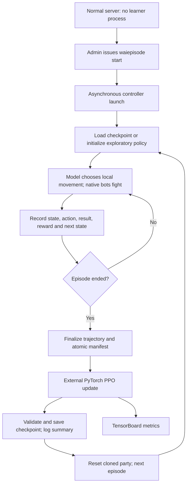

# Automatic learned-navigation episodes

Updated October 25, 2026. Source is drafted in `rl_loop.py` and `mod-wai-episodes`.
Offline validation passed on October 25: 18 learner/client tests, changed-source MSVC syntax,
six native episode helper suites, and native process stop/start-cancel/pipe-flood/exit-status checks.
**No full server build or live episode was run.** Source edits alone do not change the running server.

## On-demand operation

Normal server startup does not launch Python or load a model. After one-time configuration and
compatible deployment, `waiepisode start` requests the controller/trainer using the core's existing
asynchronous process utility. It controls the cloned party, trains after terminal gameplay episodes
and requests the next fresh episode. The same process stays alive between episodes.
`waiepisode stop` cancels cycling and requests termination of that owned process. Server shutdown
also requests termination. The last atomically published checkpoint remains on disk.

No startup-launcher changes start Python alongside worldserver.



## One-time private configuration

Set module options to real absolute paths. Angle-bracket examples are placeholders, not executable
values. Source/config edits have not been copied to the running deployment.

```ini
Wai.Episodes.Policy = "learned"
Wai.Episodes.Learner.Executable = "<workspace>/wai-learning/.venv/Scripts/python.exe"
Wai.Episodes.Learner.Script = "<workspace>/wai-learning/rl_loop.py"
Wai.Episodes.Learner.Home = "<server-home>/wai-learning-rl"
Wai.Episodes.Learner.Credentials = "<private-existing-voice-credential-file>"
Wai.Episodes.Learner.Url = "http://127.0.0.1:7878/"
```

The optional credential file uses the existing voice bridge's Username/Password JSON format.
Contents never go into arguments or logs. Alternatively inherit WAI_SOAP_USER/WAI_SOAP_PASSWORD.
Existing authenticated administrator SOAP must be enabled; the client supports loopback HTTP only.
Do not place credentials, private recordings or generated training artifacts in public repositories.

The old human-character action lease is separate. This experiment adds episode-scoped `observe`,
`act` and `training` operations available only through the administrator console/SOAP path. Episode
identity, sequence, fixed policy version, decision freshness and heartbeat reject stale control.
Movement executes on the map update; training and trajectory I/O are external.

Only isolated cloned-party episodes are supported by the learned loop. As of October 26,
scripted policy configuration is rejected and episodes are disabled rather than following a fixed
route. Missing learner configuration also rejects episode start; there is no scripted fallback.
Policy/process settings are not changed mid-run by configuration reloads.

A partial death uses a surviving party member for recovery. A full wipe ends that episode;
the learner trains from the failed trajectory, saves the checkpoint, then requests a fresh party
and instance. The October 26 offline regression exercises two consecutive wipes and checks that
training completes before repeat. This is not yet a live-server verification.

GM observation: `.appear` now rejects a conflicting personal dungeon binding. When moving between
copies of the same dungeon, it requests a full instance transfer instead of a coordinate-only
teleport. Leave the dungeon and clear only your GM's binding before retrying a rejected appear;
never unbind the bot party. This C++ fix requires a new server build.

## What learns

Sixteen fixed-scale inputs contain position/heading, tank health/resource/combat, party health,
alive/combat summaries, completed-boss count, elapsed budget, readiness and movement. They do not
contain undiscovered boss coordinates, waypoints, a boss order or a recorded route. Actions are wait
or eight heading-relative six-yard goals. Native navigation can reject movement; requested actions
and execution results are distinguished. Busy parties are limited to wait.

Native combat and follower AI remain. During learned navigation the tank's non-combat stay/grind/
follow/travel and other destination strategies are removed; stay would cancel the model's movement.
This does not teach class rotations or guarantee successful exploration. Many failed runs may be
needed before any route emerges. Generalization to arbitrary dungeons is not demonstrated.

## Model and training

The draft uses PyTorch PPO: shared 16→64→64 tanh encoder, nine-action categorical actor and scalar
value head. GAE, clipped policy ratios, value loss, entropy, Adam, minibatches and gradient clipping
drive updates. The initial policy samples exploratory actions. Each run has one fixed checkpoint;
updates occur between runs. These algorithm choices and coefficients remain unvalidated.

This is separate from the earlier 16→12→8→6 spell imitation model. Earlier successful tests do not
validate this new PPO controller. No ONNX export or independent held-out evaluation is added here.

The controller finalizes the recording and checksum manifest, then invokes training in the same
external process: no extra watcher service. Existing artifacts are not overwritten or silently
retrained. A crash leaving unconsumed artifacts requires inspection, not an automatic uncertain
replay. An OS-backed file lock prevents concurrent writers and releases on forced process exit.

## Files under the configured learner home

- `navigation.pt`: current actor/value weights, optimizer/RNG state, architecture, algorithm/reward
  settings, update counter, last episode and trajectory checksum. Fixed-scale inputs need no learned
  normalizer state. A candidate is checked before atomic replacement of the prior checkpoint.
- `episodes/<episode>/trajectory.json`: states, actions, masks, old probabilities/value estimates,
  rewards, execution results, next states and terminal flags.
- `complete.json` in that episode directory: published after trajectory close/flush; includes policy
  version, episode identity and checksum.
- `trained.json`, `summary.json`: update receipt and measured feedback.
- `tensorboard/`: losses, entropy, gradient norm, returns, clears, duration and deaths.

## Reward version 1

- +10 per newly killed required boss, once per episode.
- +1000 for full clear: all four bosses, in any order.
- -5 per actual party-member death; release/resurrection is not another death.
- -0.01 per elapsed second: otherwise-equivalent successful clears prefer less time.
- -50 for terminal gameplay failure. Early failure earns no speed-completion bonus.

Only full clear, wipe, timeout and instance exit are gameplay training outcomes. Other outcomes are
quarantined as control/infrastructure failures. Timeout is a terminal task-budget failure. Repeated
trash kills or repeated boss credit earn no reward. Coefficients need evaluation; changed weights
are not proof of improved play.

## Server feedback and GM access

Logs distinguish launch requested, policy connected, training started, completed and failed.
Training-start acknowledgement happens when the external trainer is about to update, after the
complete recording manifest. The six-line summary reports decisions used, run outcome/time/deaths,
reward, L2 weight change and before/after action probabilities in one identical recorded state.
It explicitly selects the largest sampled probability change from at most 128 states. It does not
invent a neuron's meaning or claim that changing the policy improved performance. Including status
receipts, successful training feedback stays under ten lines.

After clone login, server logs list all five names. At run start they print the current tank's GM
appear command, invisibility/outdoor teleport steps, self-only unbind and instance comparison. These
are client-chat instructions, not commands automatically executed by the server. Stay outside the
bot party and do not interact with enemies while observing.

## Performance and verification limits

Training/process waiting does not run on world/map threads. Rollouts cap at 4096 decisions and
terminal episodes clear the movement audit roster. The old outcome journal and clone DB operations
still contain blocking paths found in the lag review; this change does not claim to fix those or
prove the cause of a live incident.

`test_rl_loop.py` passed reward, mask, measured-update, complete two-episode loop and failed-training
checkpoint preservation checks using an in-memory server transport. SOAP namespace tests passed.
The native harness compiles the actual core process utility with only logging/console-conversion
stubbed; live-child stop, ten immediate-start cancellations, dual-pipe flooding and exit propagation
passed. The review found and corrected late child registration and serial pipe-draining bugs in that
utility, without changing its public header/API.

Episode and PlayerBots style checks passed. Scoped checks passed for changed core files; the full
core linter still reports pre-existing violations in unrelated files. Upstream PlayerBots fetch failed
in the environment, so synchronization remains unverified. Full server linking, actual SOAP/server
integration, game recovery and end-to-end live training are the next checks after the user's build.
