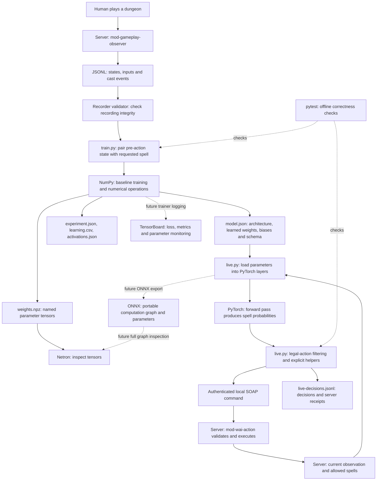
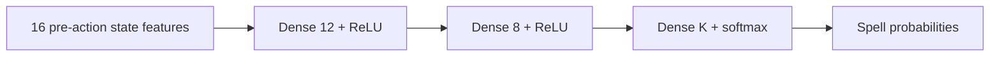

# WAI: recording, training, inspection and debugging

Updated: October 23, 2026.

Installation verified October 23: workspace-local `.venv` contains CPU PyTorch
2.14.1+cpu, NumPy 2.5.4, pytest 9.1.1 and TensorBoard 2.21.0.
`pip check` and all 11 learner/client tests passed. Loading the saved model into
PyTorch and running offline inference produced six normalized probabilities.
The existing downloaded Netron files were preserved. TensorBoard event logging
and ONNX export remain future integration work; installing tools does not add
those features. No game server or action controller was started.

Use `.\wai-learning\.venv\Scripts\python.exe` for commands: the system `python`
alias did not launch during setup. The environment was created with the available
bundled Python runtime. `Setup-Wai.ps1 -Python <working-python.exe>` also supports
an explicit interpreter when creating a new environment.

This guide describes the implementation currently in this workspace. Commands
are for PowerShell 7, run from the workspace root. They do not automatically
build or start the game server.

## 1. What exists today

| Component | Current implementation |
|---|---|
| Recorder | Server module `mod-gameplay-observer`; state snapshots and human input/cast events. |
| Dungeon files | Source now opens a named file per dungeon visit and closes it on exit/logout/stop. This change needs a matching server build/deployment. |
| Training | `wai-learning/train.py`: small NumPy behavior-cloning baseline. |
| Inference | `wai-learning/live.py`: loads the baseline parameters into standard PyTorch layers. |
| Action execution | Source for `mod-wai-action`: opt-in control of the logged-in human druid in WC. Full module compilation and live behavior have not been verified in this chat. |
| Monitoring exports | JSON weights/checkpoints/activations and CSV training metrics. |
| TensorBoard | Selected for subsequent integration; the current trainer does not write TensorBoard event files. |
| Netron/ONNX | Netron can inspect the NumPy tensors. Complete graph export to ONNX is not implemented yet. |
| Continued/multi-run training | Not implemented. Each training command initializes a fresh model from one recording. |

The long-term framework choice is PyTorch for training as well as inference,
TensorBoard for monitoring, Netron for graph inspection, and pytest for tests.
The NumPy trainer is a diagnostic baseline, not a replacement framework.

## Conceptual flow: recordings, learning, inspection and execution

There are two separate activities: **training changes the model's parameters**;
**inference uses those parameters to choose an action**. Recording gameplay does
not train anything automatically. Running the action controller does not update
its model automatically either.



Solid arrows describe implemented software paths; the server modules still
need a verified matching build and in-game test. Dotted arrows to TensorBoard
and ONNX describe planned integrations. The pytest arrows describe validation,
not movement of gameplay data. If your Markdown viewer does not render Mermaid,
the same flow is: **play → record JSONL → validate → prepare examples → train
with NumPy → save model.json → load with PyTorch → predict → filter/choose action
→ SOAP → server validation/execution → next observation**.

### Where does the model live?

The current saved model is:

**`C:\stuff\guided_work\output\wai-learning-demo\model.json`**

This is the default file loaded by `Start-Wai.ps1`. It contains the architecture,
feature order, spell order, and all learned weights and biases. For the current
demo these describe a **16-input → 12-ReLU → 8-ReLU → 6-output** network, with
362 learned parameters. `live.py` supplies the layer operations and softmax;
the JSON supplies the saved numbers and schema. Together they define the policy.

When you train into another `--output` directory, its `model.json` is a separate
model. The filename can be the same because the experiment directory identifies
the version. Training a new file does not automatically switch the running
controller: stop it and launch with `Start-Wai.ps1 -Model <new-model.json>`.
The current executor accepts only its fixed architecture and spell ordering,
so a newly trained model with a different action set may be incompatible.

When the controller runs, PyTorch loads a copy of the parameters into **CPU RAM
in the external Python process**. The model is not inside the WoW client or
the game server. The server supplies observations and validates commands;
the Python process performs inference. Exiting that process discards the RAM
copy, while the saved JSON remains on disk. The action loop does not save new
weights or learn from its receipts.

| Tool or file | Role in this flow | Current status |
|---|---|---|
| Python and `.venv` | Run training, validation, inference and monitoring tools with isolated dependencies. | Installed; use the environment's Python executable. |
| Server recorder and JSONL validator | Capture gameplay examples and detect structural problems before training. | Source available; recorder deployment determines live behavior. |
| NumPy | Array calculations, gradients and parameter updates in the small baseline trainer. | Installed and used today. |
| `train.py` | Turn one recording into training examples, train the baseline, export results. | Implemented; starts fresh each invocation. |
| `model.json` | Saved deployable policy parameters and schema. | The default live model is the demo file above. |
| `weights.npz` | NumPy archive of named weight/bias tensors for inspection. | Exported; not the file `Start-Wai.ps1` loads. |
| `experiment.json` | Provenance, validation, architecture, training details and diagnostic evaluation. | Exported; an experiment report, not the live model. |
| `learning.csv` | Numeric loss/fit history for checking training progress. | Exported; can be plotted with standard analysis tools. |
| `activations.json` | Recorded neuron values for example inputs. | Exported snapshots, not a live neuron monitor. |
| PyTorch (`torch`) | Construct layers, load saved parameters and run forward passes. Intended future training framework too. | Installed; offline model loading/inference verified. Current trainer still uses NumPy. |
| `live.py` | Combine PyTorch predictions with legal-action filtering, explicit helpers and SOAP transport. | Implemented; full live server execution unverified. |
| SOAP and `mod-wai-action` | Carry authenticated local commands and validate/execute them in the game. | Server source available; needs matching build/configuration and in-game testing. |
| `live-decisions.jsonl` | Audit model probabilities, chosen actions, helper provenance and server receipts. | Written when the controller runs; not automatically fed back into training. |
| pytest | Catch data/numerical/action-selection/transport regressions offline. | Installed; 11 current Python tests passed. Does not establish dungeon-playing competence. |
| TensorBoard | Standard browser UI for training curves and, when instrumented, parameter/activation summaries. | Installed; trainer event logging not connected yet. CSV/JSON are the current evidence. |
| Netron | Inspect model structure and tensors. | Your downloaded copy is preserved. Current NPZ supports tensor inspection; a complete WAI graph export is pending. |
| ONNX | Exchange format that bundles a computation graph and parameters for tools such as Netron. | Export not implemented; not required for current inference. |

### What learning means here

Each example is a pre-action observation paired with the spell the human
requested. Training adjusts weights to increase the probability of that spell.
Loss measures how poorly the prediction matches the label; accuracy counts
matching choices. Lower training loss alone does not demonstrate generalization:
we need independent held-out dungeon runs to assess that.

During action mode the learned part chooses spell probabilities. Target choice,
approach, autoattack, loot and optional route replay currently use explicit
helpers. They are not skills learned by this network. Future reinforcement
learning would require an additional outcome/reward and optimization loop;
neither recording nor letting this controller play creates that loop today.

## 2. Directory layout

```text
wai-learning/
  data/                         Original dungeon recordings
  .venv/                        Local Python environment
  Setup-Wai.ps1                 Install CPU dependencies
  Start-Wai.ps1                 Launch the external controller
  train.py                      Train the current baseline
  live.py                       PyTorch inference and SOAP client
  test_train.py                 Training/data numerical checks
  test_live.py                  Action-selection/transport checks
  BACKLOG.md                    Planned standard-tool integrations

output/
  wai-learning-demo/            Original 15-decision demo and live checkpoint
  wai-training/
    wc-full-2026-10-22/          Example separate full-run experiment

wai2/azerothcore-wotlk/modules/
  mod-gameplay-observer/        Recorder and JSONL validator
  mod-wai-action/               Server execution module and setup README
```

Keep original JSONL recordings unchanged. Use unique names, for example
`wc-bear-2026-10-22-run-01.jsonl`. Do not overwrite the original live checkpoint
with an experimental training run. Recording files are excluded by the learning
directory's `.gitignore`; keep credentials and private gameplay logs out of Git.

## 3. One-time Python setup

```powershell
Set-Location C:\stuff\guided_work
& .\wai-learning\Setup-Wai.ps1
```

The script requires an available `python` command. It creates `.venv`, installs
CPU PyTorch, NumPy, pytest and TensorBoard, and writes the installed package versions to
`wai-learning/installed-requirements.txt`. It does not start training, the game
server, a model controller, or a dashboard. A GPU is not needed for this model.

Confirm the environment:

```powershell
& .\wai-learning\.venv\Scripts\python.exe --version
& .\wai-learning\.venv\Scripts\python.exe -m pip show numpy torch pytest
```

If setup fails, fix the Python/pip/network error before proceeding. Activating
the virtual environment is optional: these commands use its Python explicitly.

## 4. Collect and store a recording

The enabled recorder follows the unique logged-in human, excluding bot sessions
and AI-controlled altbots. It waits when no eligible human or multiple eligible
humans are present. You do not need to configure a character GUID.

Recorder configuration:

```ini
GameplayObserver.Enable = 1
GameplayObserver.IntervalMs = 200
GameplayObserver.OutputDirectory = "gameplay-observations"
```

The output directory is relative to worldserver's working directory unless an
absolute path is configured. With the dungeon-file source update deployed:

- Dungeon entry opens a new recording; the worker stays idle outside dungeons.
- Exit, instance/observer change, logout, recorder reload/disable or shutdown
  ends, flushes and closes the current file.
- Each visit has a sanitized dungeon-name prefix and unique UTC timestamp.
- A unique run directory contains the matching named JSONL file. Re-entry into
  the same instance produces another file rather than overwriting a previous visit.
- The first line and periodic writes are flushed during capture; exit closes it.

Older builds instead write `run-.../events.jsonl` for the server recording session.
Those older recordings remain supported. Prefer a finished, closed recording for
training rather than a file still being written. Folder size displays can lag;
actual JSONL contents and validation are better evidence of capture.

Copy the completed JSONL into `wai-learning/data/`. Do not copy a directory in
place of the file, edit out inconvenient decisions, or truncate the original.

## 5. Validate a recording before training

Example filename used below:

```text
wai-learning/data/wc-bear-2026-10-22-run-01.jsonl
```

Run the actual recorder validator:

```powershell
& .\wai-learning\.venv\Scripts\python.exe `
  .\wai2\azerothcore-wotlk\modules\mod-gameplay-observer\tools\validate_observation.py `
  .\wai-learning\data\wc-bear-2026-10-22-run-01.jsonl
```

Interpret its output:

| Field | Meaning |
|---|---|
| `counts.state` | Periodic state snapshots were captured. |
| `counts.input` | Human requests were captured. They include movement/selection, not just spells. |
| `counts.episode_start` | Dungeon visits began. |
| `episodes` | Distinct dungeon episodes found. |
| `clean_shutdown` | A writer summary is present. With per-visit files, this means the writer closed that visit; the server need not have shut down. |
| `incomplete_episode` | A dungeon start has no corresponding end marker. |
| `missing_sequences` | Gaps in the record sequence. Investigate data loss. |
| `dropped` | Writer-reported dropped records; `null` when there is no summary. |
| `unmatched_cast_events` | Cast events without a matching human request. Triggered/passive effects can legitimately appear here. |
| `training_ready` | Intentionally always `false`: schema validity alone does not establish learning suitability. |

A JSON parsing error at the very end can indicate a live copy or truncated tail.
The standalone validator is strict. The trainer can explicitly discard one
incomplete final line, then validate the complete prefix; it records that fact
in `experiment.json`. Malformed complete lines or corruption in the middle fail.
Prefer obtaining the complete closed original rather than using that exception.

Do not label an unmatched execution event as a human decision. Spell ranks,
triggered effects, queued casts and wrapped cast counters complicate correlation.

## 6. Train the current baseline

Use a new output directory for each experiment:

```powershell
& .\wai-learning\.venv\Scripts\python.exe .\wai-learning\train.py `
  .\wai-learning\data\wc-bear-2026-10-22-run-01.jsonl `
  --output .\output\wai-training\wc-full-2026-10-22
```

This loads and hashes the recording, validates its complete records, extracts
pre-handler human spell requests, runs a chronological diagnostic split, then
trains the final saved model on all extracted examples. There must be at least
six complete spell decisions.

Important current behavior:

- Training starts from deterministic seed 7 every time. It does not resume from
  a previous model or incrementally add the run to the original demo model.
- The command accepts one recording, not a directory or list of files.
- Do not simply concatenate recordings: per-file sequence numbers, aliases and
  episode IDs can collide. A multi-run dataset loader/splitter is planned.
- Reusing the same output directory overwrites that experiment's artifacts.
- Only spell choice is learned. Movement packets, target selection, looting,
  bot commands, action timing and dungeon outcomes are not training targets here.
- Failed spell requests are included as attempted-action labels. This is behavior
  cloning, not reinforcement learning or proof that the action was successful.

Keep collecting independent runs. The current one-run chronological diagnostic
is correlated and is not a replacement for holding out whole dungeon runs.

## 7. Architecture, features and learning algorithm

The baseline architecture is:



`K` is the number of distinct requested spell IDs in the training recording.
The original demonstration had six, making the network 16-12-8-6 with 362
trainable parameters. The loss is multiclass cross-entropy, optimized with Adam
for 1,600 updates. The existing command does not expose hyperparameter flags.

Each dense layer computes `z = input @ weights + bias`. ReLU replaces negative
values with zero. Softmax turns the final logits into a probability distribution.
These probabilities are not a calibrated confidence or guaranteed success rate.

Feature order:

1. Self health fraction.
2. Self current-resource fraction.
3. Whether the current resource is rage.
4. Whether self is in combat.
5. Bear Form aura present.
6. Selected unit is a party ally or self.
7. Selected unit is self.
8. Selected unit is dead.
9. Selected unit health fraction.
10. Selected-unit distance divided by 100 yards, clipped to one.
11. Party mean health fraction, including self.
12. Party minimum health fraction.
13. Fraction of party in combat.
14. Fraction missing Mark of the Wild spell 5232.
15. Whether selected unit has spell 5232's aura.
16. Whether self is casting.

Features are bounded to [0,1]. The model does not receive the chosen spell,
its spell-specific cooldown, its subsequent outcome, timestamp, absolute world
position, or local actor IDs as input features. Requested target IDs are retained
in experiment examples for inspection but are not fed into the network.

Aura/spell IDs and the live executor are specific to this early druid experiment;
this is not yet a class-independent party policy. A larger entity encoder,
temporal memory and separate intent/target/movement/timing heads are conceptual
backlog items, with no trained weights or benchmark yet.

## 8. Read the results

The output folder contains:

| File | What to inspect |
|---|---|
| `README.md` | Generated experiment summary and limitations. |
| `experiment.json` | Architecture, features, spells, data hash, validation, full-data fit, chronological diagnostic, examples and saved training checkpoints. |
| `model.json` | Final weights, biases, feature order, spell order and architecture. |
| `weights.npz` | Named weight and bias tensors for inspection. |
| `learning.csv` | Training loss and training accuracy at checkpoint epochs. |
| `activations.json` | Inputs, both hidden layers and output probabilities for each training example, evaluated with the final model. |

Quick inspection in PowerShell:

```powershell
$waiExperiment = '.\output\wai-training\wc-full-2026-10-22'
$waiReport = Get-Content "$waiExperiment\experiment.json" -Raw | ConvertFrom-Json
$waiReport.architecture
$waiReport.training_samples
$waiReport.training_accuracy
$waiReport.held_out | Format-List
$waiReport.recording_validation | Format-List
Import-Csv "$waiExperiment\learning.csv" | Format-Table
```

How to interpret the results:

- Falling training loss means the model fits the provided labels better.
- High training accuracy can be memorization, especially with only a few examples.
- `held_out` is trained on the first 70% of this recording and tested on the tail.
  It is not an independent-run evaluation and can still benefit from correlation.
- Check `held_out.unseen_training_spells`: a spell absent from the training portion
  cannot be expected to be learned from that portion.
- The final `model.json` is subsequently trained on all examples; its training
  accuracy is not the held-out test result.
- Accuracy is measured at known human spell-decision instants. The network has
  not learned when to make a decision or whether waiting would be better.

Original short demo: 15/15 full-data fit and 3/5 correct on the chronological tail.
That result is preliminary evidence that the training loop runs, not evidence of
autonomous WC completion.

## 9. Inspect individual neuron activations and weights

```powershell
$waiTraces = Get-Content "$waiExperiment\activations.json" -Raw | ConvertFrom-Json
$waiDecision = $waiTraces[0]
$waiDecision | Select-Object seq, seconds, actual, predicted
$waiDecision.activations[0]  # 16 input features
$waiDecision.activations[1]  # 12 first-hidden-layer neuron activations
$waiDecision.activations[2]  # 8 second-hidden-layer neuron activations
$waiDecision.activations[3]  # K output probabilities

$waiModel = Get-Content "$waiExperiment\model.json" -Raw | ConvertFrom-Json
$waiModel.spells
$waiModel.layers[0].weights[0] # Connections from input feature 0 to hidden layer 1
$waiModel.layers[0].bias
```

The saved JSON weight layout is input-by-output. PyTorch Linear uses
output-by-input; `live.py` transposes the saved weights during import.
Use the spell list to map each output probability to its spell ID. A zero hidden
activation means that ReLU neuron is inactive for that example, not that it is
necessarily broken. Consistently inactive neurons across many examples can be
worth investigating. A large weight alone is not a reliable feature-importance
score: the rest of the network and input scale also matter.

## 10. Visualize using existing tools

### Available now: saved metrics and tensors

- Open `learning.csv` in Excel or another existing plotting tool to graph
  `epoch` against `training_loss` and `training_accuracy`. These are training
  curves, not independently validated success curves.
- Install/open the local [Netron application](https://github.com/lutzroeder/netron)
  and open `weights.npz` to inspect named tensors. This archive does not encode
  the complete computation graph; it will not show a live neuron simulation.
- Use `activations.json` to inspect per-decision hidden values and outputs.
  These are recorded traces, not a continuously updating game dashboard.

### Planned: TensorBoard and full graph export

[TensorBoard](https://docs.pytorch.org/docs/stable/tensorboard) is the selected
learning monitor. Integration still needs scalar logging for training/validation
loss and action metrics, weight/gradient histograms, and sampled hidden
activations. Installing it alone will not visualize our CSV/JSON artifacts:
the current trainer does not emit the required event files.

The main PyTorch trainer and ONNX graph export are also pending. A future ONNX
artifact will let Netron show the full layer graph and its parameters. Native
PyTorch state_dict checkpoints should remain the training/resume format; ONNX
serves inspection and deployment needs. Do not invent a new monitoring UI when
these standard tools satisfy the requirement.

## 11. Check a model before action mode

The current live loader accepts exactly:

```text
Architecture: 16, 12, 8, 6
Spell IDs:    779, 5232, 5487, 6808, 8618, 16857
              Swipe, Mark, Bear Form, Maul, Skinning, Faerie Fire
```

A full run may contain extra spells, different ranks or a different output count.
Such a model can train successfully but will be rejected by the live loader.
Do not manually relabel outputs, truncate weights, or assume the new model is
interchangeable. Extending the feature/action schema and server allowlist is
additional implementation work.

The default launcher uses `output/wai-learning-demo/model.json`. To select a
different compatible artifact, pass `-Model` explicitly. Preserve the original
working checkpoint so comparison and rollback are possible.

## 12. Launch a controlled action test

Prerequisites: matching server module built/deployed, active module configuration
enabled, SOAP listening on loopback, logged-in druid in WC, SelfBot off. Source
files alone do not add commands to an already running executable. See the full
[action-mode setup README](../wai2/azerothcore-wotlk/modules/mod-wai-action/README.md).

Start the external controller:

```powershell
& .\wai-learning\Start-Wai.ps1
```

It automatically reuses the voice bridge's saved SOAP credentials when no
explicit WAI environment override is set. It does not print or duplicate them.
Use `-VoiceCredentialPath` if the bridge store is elsewhere. If setting WAI
environment overrides, set both WAI_SOAP_USER and WAI_SOAP_PASSWORD, not just one.

After the client says ready, grant control in game:

```text
.wai start
.wai status
```

Release control with `.wai stop`, manual movement/casting/selection, or Ctrl+C
in the controller terminal. A missing controller for three seconds also revokes
the lease. Starting the controller does not build/start the server or grant
control automatically. The game client remains connected.

Optional recorded-route replay:

```powershell
& .\wai-learning\Start-Wai.ps1 `
  -Model .\output\wai-learning-demo\model.json `
  -Route .\wai-learning\data\wc-bear-2026-10-22-run-01.jsonl
```

Route replay also requires `Wai.Action.AllowRouteReplay = 1`. Start near the
recorded entrance; a route step beyond eight yards is rejected. Replay uses
path-generated server movement and cannot teleport into the recording's position.
It does not learn a new route or establish dungeon completion.

## 13. Debug live actions

Default log:

```text
output/wai-learning-demo/live-decisions.jsonl
```

Inspect recent decisions without dumping credentials:

```powershell
Get-Content .\output\wai-learning-demo\live-decisions.jsonl -Tail 10 |
  ForEach-Object { $_ | ConvertFrom-Json } |
  Select-Object sequence, source, action, result | Format-Table -Wrap
```

Sources are deliberately separated:

- `learned/...`: neural spell choice, restricted by the server's legal-action mask.
- `native/...`: busy/wait handling, target approach, autoattack or looting helpers.
- `scripted/recorded-route-replay`: movement along recorded waypoints.

The server provides one-use observation sequences, a bound candidate target,
generation matching, one-second action freshness and spell legality checks.
It never accepts arbitrary new spell IDs from this model.

| Receipt | Interpretation |
|---|---|
| `WAI_INACTIVE` | No eligible active lease. The client waits for in-game start. |
| `WAI_REJECTED: stale observation, lease or command.` | Wrong generation/sequence, reused decision, expired lease or stale snapshot. |
| `WAI_REJECTED: spell unavailable.` | Spell failed the current allowlist or server checks; no free/triggered cast is substituted. |
| `WAI_REJECTED: target disappeared.` | The observation's unit is no longer available in the player's map. |
| `WAI_CAST_REQUESTED` | A normal cast was requested; completion/damage/healing is not confirmed by this receipt. |
| `WAI_NATIVE_ATTACK` | The helper requested autoattack/chase; this was not a neural movement decision. |
| `WAI_NATIVE_LOOT_ATTEMPTED` | Ordinary loot handlers were invoked; not proof that every item was acquired. |
| `WAI_ROUTE_REPLAY` | A bounded path-generated waypoint step was requested. |
| `WAI_WAIT` | No new action was requested. |

If behavior is wrong, stop first, preserve that run's live log, and compare the
state, mask, probabilities, chosen action and receipt. Do not keep feeding WAI's
own attempts back as human demonstrations. Group rolls, loot success events,
recovery and generalized navigation remain deferred work.

## 14. Troubleshooting checklist

| Symptom | Check |
|---|---|
| No recording file | Enable configuration, matching recorder build, dungeon entry, and unique human selection. The new source intentionally creates no outside-dungeon file. |
| File display says 0 KB | Inspect contents and validate a closed copy. Older writer behavior buffered small writes; the updated writer flushes periodically and at visit close. |
| Incomplete JSON / no summary | Obtain the closed original. Keep the incomplete copy for diagnosis, not as a silently accepted finished run. |
| Too few training examples | Count spell requests, not total movement/state records. At least six complete ability decisions are required. |
| Excellent fit, poor gameplay | Check tiny-data memorization, missing context, unseen spells, failed attempts as labels, target/timing limitations and absence of a learned navigation policy. |
| Different model rejected | Compare architecture and ordered spell list with the fixed live-loader contract above. |
| `.wai` command unknown | The running executable lacks the new module; source/config changes alone are insufficient. |
| Start rejected | Check enabled module, live druid in configured map, SelfBot off, and no existing control lease. |
| Immediate timeout | Start the controller before `.wai start`; check SOAP latency/errors and the three-second heartbeat window. |
| SOAP authentication failure | Verify bridge credentials and administrator permission without printing secrets. A voice account restricted to voice-specific service access may not have general administrator SOAP permission. |
| Controller waits indefinitely | Check `.wai status`, legal spells, selected candidate, cooldown/resource/busy state, and the terminal's last receipt. |
| Route is out of range | Return near the recorded starting location or use the correct run; do not increase the bound to force a mismatched route. |
| Module works differently from this guide | Confirm the source/executable/config versions and preserve the exact model artifact used. |

## 15. Run offline tests

Preferred installed-tool workflow:

```powershell
& .\wai-learning\.venv\Scripts\python.exe -m pytest .\wai-learning -q
```

Equivalent built-in unittest entry point:

```powershell
& .\wai-learning\.venv\Scripts\python.exe -m unittest discover `
  -s .\wai-learning -p 'test_*.py' -v
```

Recorder schema checks:

```powershell
& .\wai-learning\.venv\Scripts\python.exe -m unittest discover `
  -s .\wai2\azerothcore-wotlk\modules\mod-gameplay-observer\tests -v
```

Current recorded offline evidence: eleven learning/client checks and seventeen
recorder validator checks passed. Separate isolated C++ fixtures checked lease
freshness/sequence handling and actual dungeon file open/write/close behavior.
Those checks are not a full server build or an in-game integration test.

## 16. What to save for a useful debugging session

Keep the unchanged source recording, experiment output directory, exact model,
installed package versions, server executable/source manifest, relevant config
keys, and live decision log. Record the actual command used and what you expected
versus observed. Share only relevant excerpts and remove credentials/account
linkage; never include the voice credential store.

Use complete independent runs for future train/validation/test separation. Keep
failed or unusual demonstrations with their provenance rather than deleting them
to make an accuracy number look better. Track outcome and legality separately
from imitation accuracy as the controller evolves.
