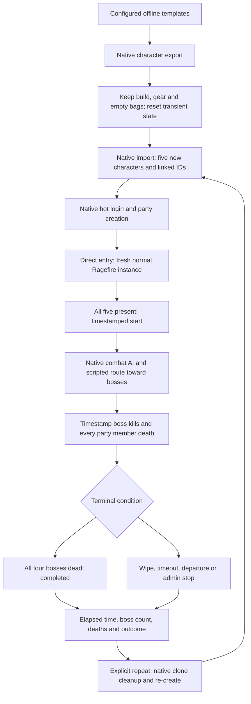

# WAI Ragefire episode harness

**October 26:** learned navigation is required; scripted routing is rejected. The command
`waiepisode start N` supports 1–4 parties feeding one shared trainer. Status, stop and cleanup
apply to the pool; `waiepisode watch N` prints that party's observation instructions. Secondary
dedicated accounts are created on demand through the native API. See `LEARNED-NAVIGATION.md`
and the learning repository's `PARALLEL-EPISODES.md`. Older baseline details below are historical.
Rebuild and live validation remain pending.

The automatic learned-navigation source is now available: see
[on-demand learned navigation](LEARNED-NAVIGATION.md). The new distribution config defaults to
`learned`; the fixed boss-route behavior described below is the explicitly selected `scripted`
comparison. Offline validation passed; a full server build and live integration are still pending.

The cloned party now has a strict movement gate and position watchdog. See
[movement integrity](MOVEMENT-INTEGRITY.md) for enforcement, limitations,
validation and configure/build commands. The matching core spline callback patch
is required; this is not a module-only update against an unmodified core.

Opt-in, single-party baseline runner for Ragefire Chasm (map 389). The five
configured characters are **read-only templates**, never the characters used
for the run. Each gets a separate clone with a new name, character GUID, item
GUIDs and remapped pet records through the existing AzerothCore dump importer.

This is an episode harness using existing PlayerBots combat AI plus a scripted
boss-route driver. It is not reinforcement learning, a neural policy, or proof
that this party can clear the dungeon. Full worldserver linking and an in-game
run still need verification. No build/server was started during implementation.

## Reused functionality

| Requirement | Existing implementation reused |
|---|---|
| Character copy | `PlayerDumpWriter::WriteDumpToString` and `PlayerDumpReader::LoadDumpFromString`, the same path as the native character-copy command. |
| Keep preset build | Native character, talent, glyph, spell, skill and equipped-item records; no random gearing or talent allocation. |
| New identities | Core importer allocates/remaps character, item and pet IDs; cache supplies the resulting clone IDs. |
| Bot login/logout | `RandomPlayerbotMgr::AddPlayerBot` / `LogoutPlayerBot`, with bot sessions and no human master. |
| Party creation | Native `Group::Create` / `AddMember`; tank leads, healer and damage dealers follow. |
| XP lock | Native `PLAYER_FLAGS_NO_XP_GAIN`, applied in the clone data and in runtime preparation. |
| Entry/isolation | Normal `Player::TeleportTo` into a newly formed normal-difficulty group instance. No copied instance binds. |
| Movement | Existing PlayerBots `MovementAction::MoveTo` and its movement gates/pathfinding/timing. |
| Combat/roles | Existing class/spec strategies; tank slot enables the native tank strategy, healer slot retains a native healing spec or enables the native heal strategy. Talents stay unchanged. |
| Boss/death events | Native unit-death hook for bosses and player-just-died hook for all player death causes. |
| Logging | Native server logger, category `server.wai.episodes`, with `WAI_EPISODE` JSON payloads. |
| Clone cleanup | Native logout and `Player::DeleteFromDB`, restricted to IDs allocated by this harness. |

New code coordinates those APIs, sanitizes the copied inventory/state, tracks
one episode, checks four boss deaths, and emits timing/outcome receipts. There
are no core-wide header or PlayerBots engine edits. Upstream PlayerBots fetch
was attempted but failed due to local networking; synchronization is unverified.

## Configuration

Enable this in the loaded server configuration, or install the module's
`conf/wai.conf.dist` as its loaded module configuration file. Names below
are synthetic; put your actual template names in your local configuration only.

```ini
Wai.Episodes.Enable = 1
Wai.Episodes.TimeoutSeconds = 3600
Wai.Episodes.Account = "TRAINING_ACCOUNT"
Wai.Episodes.Tank = "Exampletank"
Wai.Episodes.Healer = "Examplehealer"
Wai.Episodes.Damage1 = "Exampleone"
Wai.Episodes.Damage2 = "Exampletwo"
Wai.Episodes.Damage3 = "Examplethree"
```

Use an **existing dedicated account**, created with the native account
administration command. It must not be a human account or an account in the
random-bot pool. Do not log into this account with a game client. Credentials
are not part of this module's config or logs. Only an empty account, recorded owned clones, or an explicitly recovered legacy
clone roster is accepted; unrelated characters are never silently adopted.

Templates must be distinct, offline, same faction and levels 13 through 20.
Different races are supported. Supported tank classes are warrior, paladin and
druid; supported healer classes are priest, paladin, druid and shaman. Configure
appropriate gear/talents/learned spells yourself; the harness does not optimize
or fix those builds. Sources are read from their saved database state.

The snapshot keeps equipped items, their enchantments, and equipped bag shells.
Backpack/bag contents, bank contents, mail, quest progress, temporary auras and
cooldowns are omitted. Money and XP progress reset to zero, while **level stays
the same**. Login/transport/instance/GM state is cleared. Initial health/resources
and durability are restored through native APIs. Learned skills, glyphs, spells,
talents and pets are copied. No public raw dump files are written.

**Empty inventory includes ammunition, food and reagents.** Hunters and some
abilities may need supplies. Existing server bot-cheat settings can also affect
that behavior. This version does not silently grant consumables or change
global cheat settings. Choose and document a supply policy before comparing
performance; an empty-inventory party is not necessarily combat-ready.

## Commands

Administrator in-game commands (omit the leading dot in the server console):

```text
.waiepisode start
.waiepisode recover
.waiepisode status
.waiepisode stop
.waiepisode repeat
.waiepisode cleanup
```

- `start`: read configuration, snapshot all five offline templates, create five
  clones, log them in as bots, form a party and enter Ragefire. After a restart, recorded clones are reset automatically on the same account.
  Use recover once for legacy clones. Only one harness party runs at a time.
- `status`: emit a status receipt in the server logs.
- `stop`: terminate an active/setup episode with an admin-stop outcome. It does
  not delete characters; the bots are held in place outside combat once their
  instance update observes the finished state. Native combat reactions may
  continue if they are already fighting.
- `repeat`: after a terminal episode, log out and remove only this process's
  clones, wait for deletion to be visible, then create a new party from the
  same captured snapshots. This restores preset items/builds/skills/pets as well
  as inventory and XP state. Original templates are untouched. A repeat is
  explicit; there is no infinite automatic loop.
- `cleanup`: after a terminal episode, remove only this process's clones and
  return to empty state. A later `start` reads fresh templates/configuration.

Command replies confirm **queueing**, not success. Watch the log receipts for
setup failures, actual start and terminal outcomes. Setup times out after two
minutes. Pending bot logins fail closed for cleanup; wait for them to settle
and retry rather than forcing deletion of a character loading in parallel.

Template snapshots remain process-local. Clone ownership is persisted in the private
state directory. After restart, start reloads the configured templates and resets
recorded clones on the same account; recover explicitly handles pre-ledger clones.
See account-recovery details below.

## Run lifecycle and completion



Required boss entries, taken from local world data:

| Boss | Creature entry |
|---|---:|
| Oggleflint | 11517 |
| Taragaman the Hungerer | 11520 |
| Jergosh the Invoker | 11518 |
| Bazzalan | 11519 |

The native encounter data marks Taragaman as Dungeon Finder completion credit;
that alone is insufficient for this experiment. This tracker requires all four
unique entries to die in the party's instance. Duplicate boss-death notices do
not increase progress. Boss destinations are read from the core's loaded normal
spawn data; setup fails if a required boss has no unique normal spawn.

The timer starts only after all five clones arrive in the same instance. The
route driver initially allows ten seconds to settle, then checks at two-second
intervals. It waits for living, nearby party members, no active combat/casts,
at least 80% health and 60% mana for mana users before advancing the leader.
Normal bot strategies handle pulls/combat, following, healing and recovery.
A full-party death is a terminal wipe. The driver is a baseline script, not
learned navigation; pathing, supplies, native combat behavior and the particular
level-15 builds may still prevent a clear. Route waits and a 30-second heartbeat
make a stalled run visible.

## Logs and interpretation

Every payload contains event, episode ID, wall-clock Unix timestamp in
milliseconds, monotonic elapsed milliseconds, map/instance, unique boss count,
required boss count and total player deaths. The surrounding native log prefix
also displays the server's normal timestamp. Payloads contain no credentials or
account names. Clone names and stable member slots identify the five participants.

Events: `clone_created`, `prepared`, `start`, `boss_kill`, `death`, `heartbeat`,
`route_wait`, `end`, `cleanup`, `status`, `error`. A completed run ends with
`outcome = completed_all_bosses`; other reasons remain explicitly distinguishable.
Final elapsed time for completion is anchored to the fourth boss's death event,
not the later world tick that processes the queue. Deaths are player deaths,
not pet deaths. Boss/death notices are instance-filtered.

Illustrative payload only (not a real completed run):

```json
{
  "event": "boss_kill",
  "episode": "example-run",
  "timestamp_ms": 1000000123456,
  "elapsed_ms": 123456,
  "map": 389,
  "instance": 42,
  "bosses_killed": 1,
  "bosses_required": 4,
  "deaths": 0,
  "boss_entry": 11517,
  "boss": "Oggleflint"
}
```

Use your existing native server console/file appenders. Ensure the logger for
`server.wai.episodes` inherits INFO logging and both desired appenders. No second
custom log framework is introduced.

These are episode outcome logs, **not a complete RL transition dataset**. The
current human gameplay recorder excludes bot sessions. Bot state/action
collection, rewards, a trainable controller, policy versions, held-out evaluation
and parallel-party scheduling remain separate work. Do not treat runs from this
harness as learned-model performance.

## Source checks and build status

Validation performed without configuring/building/starting worldserver:

- MSVC `/Zs` syntax check of the actual module with the existing build project's
  include paths and preprocessor definitions.
- Isolated executable tests of dump sanitization, escaped-value preservation,
  retention/removal of linked items, preservation of talent/spell/skill/pet rows,
  malformed-input rejection and unique all-four-boss accounting.
- Formatting and scoped core C++ codestyle checks.

The reusable offline check is
`client-patch-tools/episode-tests/check_source.py` in the enclosing workspace.
Its output stays under `output/wai-episode-checks`. The module has not been
linked into worldserver or tested against a live database/map.

Adding a module requires a requested CMake configure before a requested build
so the loader and source list include it. Use the workspace build wrapper, with
one job/worker and the disk guard. No widely included header changed; shared
headers are not forcing a broad rebuild, though CMake/module-loader changes can
recompile affected module sources and require relinking worldserver.


## Separate episode JSONL recordings

`Wai.Episodes.OutputDirectory = "wai-episodes"` selects the output root. Relative
paths resolve from the server working directory; an absolute local path avoids
ambiguity. Each clone-creation attempt reserves a new directory named
`RagefireChasm-<episode-id>` and writes plain `events.jsonl` there. Existing run
directories are never reused or overwritten. File output is independent of
logger levels and contains no server prefixes. Each receipt includes
`schema_version: 1` and is flushed immediately. The file captures setup, start,
boss deaths, member deaths, movement violations and terminal outcomes; later
status/cleanup receipts may follow the end marker. It closes at the next episode
or server shutdown. Startup/config validation failures before an episode exists
remain server-log-only. Output creation failure prevents cloning; write failure
ends active/setup episodes with `recording_write_failed`. Incomplete recordings
should be excluded from evaluation. A process crash may leave no end marker.

These files are outcome/evaluation records, not observation-action transitions.
Do not feed them directly to the existing human-gameplay imitation trainer: its
schema and training objective differ. RL still needs per-decision observations,
chosen actions, rewards, terminal flags and policy identity linked to episode ID.
The current controller remains native bots plus the scripted boss route. The
older human `gameplay-observations` recordings remain separate and unchanged.

Implementation validation: syntax-only module checks and isolated journal tests
cover immediate file visibility, run separation, collision rejection and invalid
output directories. No server build/start was initiated for this change.


## Reusing the training account across restarts

The training account no longer needs to be empty when it contains clones owned
by this harness. Ownership is persisted in the private account-scoped ledger
under `Wai.Episodes.StateDirectory` (default `wai-episode-state` relative to the
server home). Preserve this directory across releases and restarts. No database
schema changes or credentials are stored in the ledger. GUID and name must both
match before automatic recovery; account membership is checked against native
character data. A corrupt/unreadable ledger fails closed.

After a restart use `waiepisode start`: validate templates and the complete
existing roster, remove recorded clones through native APIs, wait for DB deletion
to complete, then recreate a clean party on the SAME account from the templates.
Clones receive new names/IDs; their old dungeon progress is not resumed. During
the same process use `repeat` after a terminal episode as before.

For legacy clones created before the ledger existed, use `waiepisode recover`
once. This explicitly adopts and resets the configured account's existing
clone-shaped roster: at most five offline characters, each named Wai followed
by eight lowercase letters, levels 13..20, all on the dedicated non-random
account. Templates cannot belong to this account. All entries are checked before
any deletion. Online members, unrelated names and oversized rosters are rejected.
Recovery removes/recreates these characters, not the account or its templates.
Subsequent restarts use ordinary `start` because ownership is now recorded.
The administrator should use recover only on the dedicated training account.

New receipts include recovered_clones and explicit ownership-ledger failures.
Creation flushes ownership immediately after the native import resolves its GUID.
A crash between import and persistence may require explicit legacy recovery.
Append-only ledger history is private local state and must not be committed.
